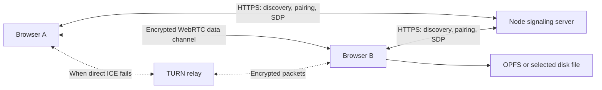

# Архитектура / Architecture

[Русское описание](../README.md) · [English overview](../README.en.md)

## Поток данных / Data flow

Файлы и текст идут по WebRTC. HTTPS обслуживает обнаружение, пары, SDP, выдачу временных TURN-реквизитов и технические события. Сервер приложения не принимает содержимое файлов через HTTP. TURN обрабатывает сетевые пакеты, но не собирает файлы в серверное хранилище.

Files and text travel over WebRTC. HTTPS carries discovery, pairing, SDP, temporary TURN credentials and technical events. There is no HTTP file-content upload endpoint. TURN buffers/forwards network traffic but does not assemble files into application storage.

## Соединение / Connections

- `lib/signaling.ts`, `lib/peers.ts`, `server.mjs`: HTTP signaling and presence; no separate WebSocket server is required.
- `discovery.mjs`: nearby means a shared public egress address, not a LAN multicast scan. Shared NAT may group unrelated people; VPNs may separate devices in the same room. Device discovery is not proof of trust.
- `pairing.mjs`: four-digit codes, two-minute expiry, recipient confirmation, limits per identity/network and globally. Optional persistent pairs in `PAIRING_STORE`.
- `lib/browser-identity.ts`: random identity stored in localStorage, not a hardware serial number or fingerprint. Private browsing/clearing storage changes it. The short UI label is not an authentication secret.
- `lib/clipboard-channel.ts`: preconnected peer and text transport. Browser text sharing requires user actions; it is not background synchronization of the operating system clipboard.
- ICE uses STUN by default; optional TURN is configured server-side. Direct candidates can work across different networks. “Direct” means no TURN relay, not necessarily a local Wi-Fi path. VPN routing can still affect it.

Автообнаружение основано на внешнем IP; знакомство по коду связывает браузерные идентификаторы. Их нужно беречь как данные браузера. Четырёхзначный код предназначен для краткого подтверждаемого знакомства, а не для постоянного доступа.

## Передача и запись / Transport and storage

`lib/p2p.ts` implements reliable ordered RTCDataChannel transfer, bounded flow control, pacing, block hashes and acknowledgments. Blocks are 256 KiB. `lib/connection-diagnostics.ts` and `lib/transfer-meter.ts` expose route and timing data. Reconnection must reconcile the sender with the receiver's accepted checkpoint, not simply continue from bytes queued in the browser.

`lib/disk-store.ts` selects a receiver backend:

1. **OPFS**: `public/storage-worker.js` writes data off the main thread. Acknowledged checkpoints follow flush and an IndexedDB update. An uncommitted tail is truncated when reopening. Data is stored on the device, not kept as a complete in-memory file; browser quotas still apply. Recovery needs the room/transfer identity and source file, and can fail if the browser evicts site data.
2. **Direct file**: `lib/direct-file-store.ts` writes via `FileSystemFileHandle.createWritable()`. Hash verification precedes writing; acknowledgments follow successful writes. The browser commits the selected file when `close()` succeeds. Until then, checkpoints are in memory and support network reconnects in the same tab, not restart recovery. Closing or reloading the receiver requires restarting the transfer. A failed write/close cannot be reported as successful completion.

OPFS-контрольные точки сохраняются на устройстве; контрольные точки прямой записи живут только во вкладке. Нельзя считать подтверждение отдельного блока гарантией сохранения целого пользовательского файла: в прямом режиме требуется успешный `close()`.

## Browser support / Поддержка браузеров

The build targets Chrome 109, Firefox 115 and Safari 17 syntax. That does **not** guarantee every API exists or every release works equally well. WebRTC, secure context APIs, OPFS, save picker, clipboard, camera capture and wake locks are detected or constrained separately.

| Feature | Practical limitation |
|---|---|
| WebRTC | NAT/firewall policies can require TURN or prevent all routes |
| OPFS | Browser quota and eviction policies; disk space alone is not enough |
| Direct-to-file | Requires `showSaveFilePicker`; mainly desktop Chromium browsers |
| Clipboard paste | Depends on clipboard formats and browser permission/user activation |
| Mobile camera | Uses file-input capture; camera/file chooser behavior is platform-dependent |
| Screen wake lock | May be released on hidden pages or by the OS; reacquisition is best effort |
| Background transfers | Browsers/OS can freeze or discard tabs, especially on phones |

Цель — удобный браузерный сценарий; непрерывная фоновая передача при закрытом браузере не поддерживается. На разных сетях скорость зависит от обоих интернет-каналов, потерь, оператора, VPN, маршрута и пропускной способности TURN. Автоматический маршрут не означает автоматический выбор самого быстрого пути.

## Scope and known issues / Известные ограничения

- One outgoing file at a time per tab; keep both pages open during transfer.
- Pairing persistence depends on configuring a persistent server store and retaining browser storage.
- Receiver direct-save recovery after page reload is not implemented.
- A connection-error message containing the Russian word for “saved” can currently be classified as `storage` in diagnostic logs. Interpret that category together with stage, network and completion events; it is not proof of a full disk.
- Client revision 28 and backend health revision `27-vps` are independent; a differing health revision is not itself an outdated-client error.
- Single-process in-memory signaling: simply adding replicas behind a load balancer is insufficient. Shared state/routing and cross-process pairing coordination would need design work.
- Tests cover deterministic storage/protocol failure cases; they cannot prove performance across every ISP, NAT and device. There is no guaranteed transfer speed or universal success rate.

The source snapshot includes the working application, tests and deployment examples, not old ad-hoc network experiments, live records or server credentials.
